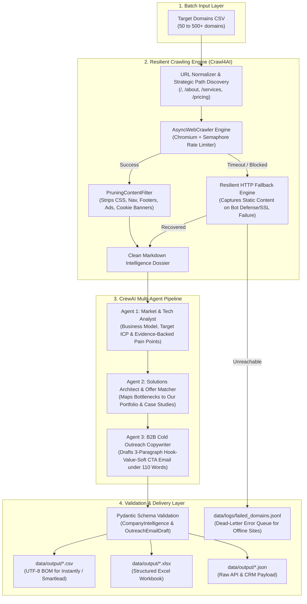
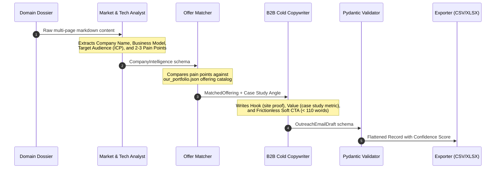

# 🚀 Autonomous Competitor Intelligence & Hyper-Personalized Cold Outreach Pipeline

<div align="center">

**[English](README.md)** • **[فارسی](README.fa.md)**

</div>

[](https://www.python.org/)
[](https://github.com/unclecode/crawl4ai)
[](https://github.com/crewAIInc/crewAI)
[](https://docs.pydantic.dev/)
[](https://www.docker.com/)
[](LICENSE)

An enterprise-grade, asynchronous B2B pipeline designed to automate competitor intelligence gathering, value proposition matching, and high-conversion cold email drafting. Built for modern B2B revenue teams, outbound agencies, and sales development representatives (SDRs).

Instead of wasting dozens of hours manually reading company websites and writing repetitive templates that trigger spam filters, this system automatically crawls target domains across strategic subpages, uncovers concrete bottlenecks, maps them against your agency's service portfolio, and generates hyper-personalized, 3-paragraph cold emails based on the proven **`Hook -> Value -> Soft CTA`** framework.

Output datasets are generated in standardized **CSV, Excel (.xlsx), and JSON** formats engineered for direct, zero-friction import into modern sales engagement platforms such as **Instantly.ai**, **Smartlead.ai**, **Lemlist**, and **Apollo.io**.

---

## 🏗️ System Architecture

The pipeline connects three battle-tested open-source paradigms into a unified, rate-limited batch architecture:

1. **[Crawl4AI](https://github.com/unclecode/crawl4ai):** High-speed asynchronous browser crawler powered by Playwright/Chromium. Handles heavy JavaScript rendering, strips boilerplate/cookies/ads using `PruningContentFilter`, and compiles multi-page dossiers (`/`, `/about`, `/services`, `/pricing`). Includes an automatic HTTP + BeautifulSoup resilient fallback.
2. **[CrewAI Examples](https://github.com/crewAIInc/crewAI-examples):** Sequential multi-agent orchestration modeled after enterprise patterns (`lead-score-iq` and `marketing_strategy`). Enforces strict output validation through Pydantic schemas to eliminate hallucinations.
3. **[Cold Email Generator](https://github.com/codebasics/cold-email-generator):** Dynamic portfolio matching engine that pairs uncovered client pain points with your organization's specific service offerings, proof metrics, and case studies (`config/our_portfolio.json`).



---

## 🤖 Multi-Agent Workflow & Task Breakdown



### 1. Market & Tech Intelligence Analyst
- **Role:** `Senior B2B Market & Tech Intelligence Analyst`
- **Objective:** Scrutinizes website content, strips away promotional fluff, identifies formal company branding, clarifies revenue model, and discovers 2-3 concrete operational, conversion, or messaging bottlenecks backed by literal text citations.
- **Output:** `CompanyIntelligence` Pydantic model.

### 2. Solutions Architect & Offer Matcher
- **Role:** `B2B Solutions Architect & Offer Matcher`
- **Objective:** Examines the analyst's findings and cross-references them with our active portfolio (`config/our_portfolio.json`). Selects the single best-fitting service offering and matches it with a proven quantitative case study metric.
- **Output:** `MatchedOffering` Pydantic model.

### 3. B2B Cold Copywriter
- **Role:** `High-Converting B2B Cold Outreach Copywriter`
- **Objective:** Crafts a punchy, non-spammy cold email using modern enterprise outreach conventions:
  - **Subject Line 1 & 2:** Short, curiosity or pain-driven (2 to 5 words).
  - **Paragraph 1 (Hook):** Direct, specific observation showing genuine familiarity with their current website/product.
  - **Paragraph 2 (Value):** Seamless transition explaining how we solved that exact bottleneck, citing a relevant metric.
  - **Paragraph 3 (Soft CTA):** Low-friction question asking permission to share a short video or 1-page breakdown (zero aggressive calendar links).
- **Output:** `OutreachEmailDraft` Pydantic model.

---

## 📁 Repository Structure

```text
├── config/
│   ├── our_portfolio.json          # Portfolio catalog: value props, services & case studies
│   └── settings.py                 # Pydantic Settings for crawler, LLM keys, and paths
├── data/
│   ├── input/sample_domains.csv    # Sample domain input list
│   ├── output/                     # Generated CSV, Excel, and JSON campaign files
│   └── logs/failed_domains.jsonl   # Dead-letter error queue for unreachable domains
├── src/
│   ├── agents/
│   │   ├── crew_pipeline.py        # CrewAI 3-agent orchestration with heuristic fallback
│   │   └── schemas.py              # Pydantic schemas (CompanyIntelligence, OutreachEmailDraft)
│   ├── crawler/
│   │   ├── cleaner.py              # Markdown sanitization, link stripping & page aggregation
│   │   └── engine.py               # Crawl4AI AsyncWebCrawler + HTTP fallback engine
│   ├── pipeline/
│   │   ├── batch_processor.py      # Batch runner with Semaphore concurrency & rate limiting
│   │   └── exporter.py             # Formatter for Instantly / Smartlead / Lemlist schemas
│   └── cli.py                      # Rich terminal CLI with interactive progress tracking
├── tests/
│   └── test_pipeline.py            # Automated pytest suite
├── .env.example                    # Environment variable configuration template
├── docker-compose.yml              # One-command Docker orchestration
├── Dockerfile                      # Production Docker container with Playwright Chromium
├── requirements.txt                # Pinned production dependencies
└── README.md                       # Comprehensive engineering documentation
```

---

## ⚙️ Environment Configuration (`.env`)

Copy `.env.example` to `.env` in the root directory:

```bash
cp .env.example .env
```

Configure your parameters:

```env
# LLM Provider Keys (At least one required for AI generation)
OPENAI_API_KEY=sk-proj-...
GEMINI_API_KEY=AIzaSy...
ANTHROPIC_API_KEY=sk-ant-...
GROQ_API_KEY=gsk_...

# LLM Model Selector
# Examples: "gpt-4o-mini", "gpt-4o", "gemini/gemini-1.5-flash", "groq/llama-3.3-70b-versatile"
LLM_MODEL=gpt-4o-mini
LLM_TEMPERATURE=0.2

# Crawler Engine Configuration
CRAWLER_HEADLESS=true
CRAWLER_CONCURRENCY=5
CRAWLER_PAGE_TIMEOUT_MS=30000
CRAWLER_WORD_COUNT_THRESHOLD=15
MAX_SUBPAGES_PER_DOMAIN=3

# Cold Outreach Configuration
DEFAULT_OUTREACH_LANGUAGE=en
RATE_LIMIT_DELAY_SECONDS=1.0
```

> [!NOTE]
> **Zero-Key Test Mode:** If no LLM API key is detected, the pipeline automatically activates its **Deterministic Smart Fallback**. This allows complete testing of the crawler, multi-page aggregator, and CSV/Excel exporters without consuming API credits.

---

## 🚀 Installation & Quickstart

### Method 1: Local Installation (Recommended with `uv`)

```bash
# 1. Clone repository
git clone https://github.com/Me0w004/Autonomous-Competitor-Intelligence-Hyper-Personalized-Cold-Outreach-Pipeline.git
cd Autonomous-Competitor-Intelligence-Hyper-Personalized-Cold-Outreach-Pipeline

# 2. Create and activate virtual environment
uv venv .venv
# On Windows:
.venv\Scripts\activate
# On Linux/macOS:
source .venv/bin/activate

# 3. Install dependencies
uv pip install -r requirements.txt

# 4. Install Playwright browser binaries
playwright install chromium
```

### Method 2: Docker & Docker Compose

```bash
# Build and run the batch container
docker-compose up --build
```

---

## 💻 CLI Commands & Usage Guide

The system includes a dedicated terminal interface featuring live progress meters, styled summaries, and execution metrics:

### 1. Batch Execution Across Multiple Domains
Processes a CSV list of company domains concurrently with rate limiting and automatic export:

```bash
python src/cli.py run --input data/input/sample_domains.csv --concurrency 5 --delay 1.0 --lang en
```

**Options:**
- `--input, -i`: Path to the input CSV file.
- `--output-name, -o`: Custom base name for exported files.
- `--concurrency, -c`: Maximum concurrent crawl workers (default: `5`).
- `--delay, -d`: Rate-limiting pause between domains in seconds (default: `1.0`).
- `--lang, -l`: Email output language (`en` or `fa`, default: `en`).

### 2. Single Domain Live Audit & Draft Preview
Quickly audits a single domain and prints the extracted intelligence, identified pain points, and cold email draft directly in the terminal:

```bash
python src/cli.py test-domain linear.app
```

### 3. Inspect Service Portfolio & Value Props
View the current active services and proof metrics loaded from `config/our_portfolio.json`:

```bash
python src/cli.py portfolio
```

### 4. System Diagnostics & Health Check
Verifies LLM API key configurations, directory structures, and runtime dependencies:

```bash
python src/cli.py diagnostics
```

---

## 📊 Export Data Format (Instantly & Smartlead Compatible)

Exported files (`data/output/campaign_*.csv` and `data/output/campaign_*.xlsx`) provide standardized columns mapped to custom merge variables in cold outreach software:

| Column Name | Description | Example Value |
| :--- | :--- | :--- |
| `Domain` | Clean domain of the prospect | `linear.app` |
| `Company_Name` | Formal brand name extracted from site | `Linear` |
| `Business_Model` | Identified business model | `B2B Project Management SaaS` |
| `Target_Audience` | Core customer profile (ICP) | `High-growth engineering and product teams` |
| `Identified_Pain_Point`| Specific bottleneck identified on website | `Scaling inbound triage and sprint automation` |
| `Evidence_Snippet` | Direct site citation backing the finding | `Manual issue tracking workflows mentioned in docs` |
| `Matched_Service` | Corresponding offering from our portfolio | `Autonomous AI Agent Workflows & Automation` |
| `Personalized_Subject_1` | Curiosity subject line (under 5 words) | `quick idea for Linear` |
| `Personalized_Subject_2` | Pain-focused subject line | `scaling Linear's pipeline` |
| `Email_Body_Draft` | Complete 3-paragraph personalized email | `Hook + Value Proposition + Low-friction Soft CTA` |
| `Hook_Sentence` | Individual opening sentence variable | `Was reviewing linear.app and noticed...` |
| `Value_Sentence` | Individual case study / value variable | `We recently built an autonomous pipeline for...` |
| `Soft_CTA` | Low-friction CTA variable | `Open to checking out a 90-second loom?` |
| `Confidence_Score` | Match confidence score (0.00 to 1.00) | `0.88` |
| `Status` | Processing status | `SUCCESS` or `FAILED` |
| `Pages_Crawled` | Total pages crawled for this domain | `3` |
| `Error_Message` | Recorded error reason (if failed) | `None` |

---

## 🛡️ Production Edge-Case Resilience

1. **Unreachable Sites & 404s:** When a website is offline, times out, or returns a 404, it is flagged with status `FAILED` and recorded into `data/logs/failed_domains.jsonl`. The batch pipeline continues uninterrupted.
2. **Cloudflare & Anti-Bot Mitigations:** Includes randomized User-Agents, desktop viewport emulation, disabled headless detection, and an asynchronous fallback using HTTP + BeautifulSoup when headless browser navigation is blocked.
3. **Invalid SSL Certificates:** Enforces `ignore_https_errors=True` and `ssl=False` so domains with expired or misconfigured SSL certificates can still be analyzed.
4. **Rate Limiting & Anti-Ban Protections:** Configurable per-domain delays and concurrency semaphores prevent IP bans and local memory exhaustion.

---

## 🧪 Testing

Execute the automated test suite with pytest:

```bash
pytest tests/test_pipeline.py -v
```

All 6 test suites validate:
- URL normalization (HTTP -> HTTPS, trailing slashes, clean hostnames).
- Markdown sanitization (removal of base64 images, link URLs, whitespace normalization).
- Multi-page intelligence dossier assembly.
- Portfolio schema and case-study loader.
- Pydantic models serialization and validation.
- Output generation across CSV (UTF-8 BOM), Excel (.xlsx), and JSON.

---

## 📄 License

This project is licensed under the MIT License - see the [LICENSE](LICENSE) file for details.
