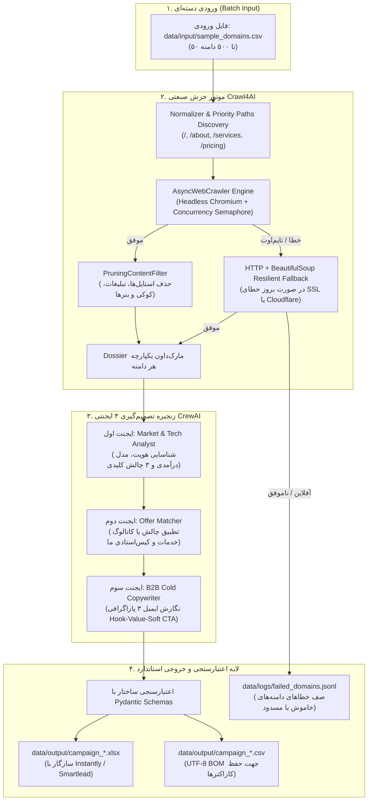

# 🚀 Autonomous Competitor Intelligence & Hyper-Personalized Cold Outreach Pipeline

یک خط لوله صنعتی، مدرن و عملیاتی در حوزه فروش B2B جهت **خزش خودکار وب‌سایت‌های هدف، تحلیل عمیق مدل کسب‌وکار و نقاط درد (Pain Points)، تطبیق با کاتالوگ خدمات ما، و نگارش ایمیل‌های سرد فوق‌شخصی‌سازی‌شده (Hyper-Personalized Cold Outreach)** بر اساس الگوی ۳ پاراگرافی `Hook -> Value -> Soft CTA`.

این موتور خروجی‌های ساختاریافته در قالب **CSV، Excel و JSON** تولید می‌کند که مستقیماً قابل بارگذاری (Upload/Import) در پلتفرم‌های مطرح ارسال ایمیل سرد مانند **Instantly.ai**، **Smartlead.ai**، **Lemlist** و **Apollo** هستند.

---

## 🏗️ معماری پایپلاین (System Architecture)

سیستم از ترکیب هسته بهترین ابزارهای تست‌شده متن‌باز ساخته شده است:
1. **Crawl4AI (`unclecode/crawl4ai`):** موتور خزش همگام، رندر جاوااسکریپت با کرومیوم، حذف نویزها با `PruningContentFilter` و استخراج ساختاریافته متون صفحات کلیدی (`/`, `/about`, `/services`, `/pricing`).
2. **CrewAI Examples (`crewAIInc/crewAI-examples`):** پیاده‌سازی معماری سه ایجنتی متوالی (Sequential Multi-Agent Crew) با مدل‌های داده Pydantic جهت پیشگیری از خطای توهم.
3. **Cold Email Architecture (`codebasics/cold-email-generator`):** ماتریس تطبیق خودکار نیازهای مشتری با مهارت‌ها و نمونه‌کارهای ارائه‌دهنده (`config/our_portfolio.json`).



---

## 📁 ساختار پوشه‌بندی و فایل‌ها

```text
├── config/
│   ├── our_portfolio.json      # کاتالوگ مهارت‌ها، ارزش‌های پیشنهادی و نمونه‌کارهای ما
│   └── settings.py             # مدیریت تنظیمات و متغیرهای محیطی با Pydantic Settings
├── data/
│   ├── input/                  # فایل‌های CSV ورودی (شامل دامنه‌های هدف)
│   ├── output/                 # نتایج نهایی (CSV، Excel، JSON)
│   └── logs/                   # لاگ دامنه‌های ناموفق (failed_domains.jsonl)
├── src/
│   ├── agents/
│   │   ├── crew_pipeline.py    # پیکربندی ۳ ایجنت و تسک‌های CrewAI + فال‌بک هوشمند
│   │   └── schemas.py          # ساختارهای Pydantic (CompanyIntelligence, OutreachEmailDraft)
│   ├── crawler/
│   │   ├── cleaner.py          # فیلترسازی متون، استخراج متادیتا و تلفیق صفحات
│   │   └── engine.py           # موتور همگام Crawl4AI و فال‌بک مقاوم HTTP
│   ├── pipeline/
│   │   ├── batch_processor.py  # هماهنگ‌کننده پردازش دسته‌ای با Semaphore و Rate Limiter
│   │   └── exporter.py         # تولید خروجی استاندارد برای ابزارهای ارسال انبوه
│   └── cli.py                  # رابط خط فرمان مدرن و زنده (Rich + Typer)
├── tests/
│   └── test_pipeline.py        # تست‌های اعتبارسنجی پایپلاین
├── .env.example                # قالب متغیرهای محیطی
├── docker-compose.yml          # استقرار سریع کانتینری
├── Dockerfile                  # تصویر Docker همراه با ملزومات کرومیوم
├── requirements.txt            # پکیج‌های پایتون مورد نیاز
└── README.md                   # مستندات فنی و راهنمای راه‌اندازی
```

---

## ⚙️ راهنمای متغیرهای محیطی (`.env`)

یک فایل با نام `.env` در ریشه پروژه ایجاد کرده و مقادیر زیر را در آن تنظیم کنید:

```env
# کلیدهای API مدل‌های زبانی (حداقل یکی را وارد کنید)
OPENAI_API_KEY=sk-proj-...
GEMINI_API_KEY=AIzaSy...
ANTHROPIC_API_KEY=sk-ant-...
GROQ_API_KEY=gsk_...

# مدل زبانی مورد استفاده (پیش‌فرض: gpt-4o-mini)
LLM_MODEL=gpt-4o-mini
LLM_TEMPERATURE=0.2

# تنظیمات خزشگر Crawl4AI
CRAWLER_HEADLESS=true
CRAWLER_CONCURRENCY=5
CRAWLER_PAGE_TIMEOUT_MS=30000
CRAWLER_WORD_COUNT_THRESHOLD=15
MAX_SUBPAGES_PER_DOMAIN=3

# زبان ایمیل‌ها و تاخیر بین درخواست‌ها
DEFAULT_OUTREACH_LANGUAGE=en
RATE_LIMIT_DELAY_SECONDS=1.0
```

> [!NOTE]
> در صورتی که کلید API تنظیم نشده باشد، پایپلاین با **مولد هیوریستیک هوشمند (Deterministic Fallback)** اجرا می‌شود تا بتوانید کل ساختار خزش، اعتبارسنجی و خروجی را پیش از اتصال کلید پروداکشن تست کنید.

---

## 🚀 نصب و راه‌اندازی سریع

### روش ۱: اجرای مستقیم با پایتون (توصیه‌شده با `uv`)

```bash
# ایجاد محیط مجازی با پایتون 3.11
uv venv .venv
.venv\Scripts\activate   # در ویندوز (یا source .venv/bin/activate در لینوکس/مک)

# نصب وابستگی‌ها
uv pip install -r requirements.txt

# نصب مرورگر کرومیوم برای Playwright و Crawl4AI
playwright install chromium
```

### روش ۲: اجرای کانتینری با Docker Compose

```bash
docker-compose up --build
```

---

## 💻 راهنمای دستورات خط فرمان (CLI Reference)

پایپلاین مجهز به یک رابط ترمینال پیشرفته همراه با پروگرسبار زنده و جدول‌های تفکیکی است:

### ۱. پردازش دسته‌ای دامنه‌ها (Batch Execution)
```bash
python src/cli.py run --input data/input/sample_domains.csv --concurrency 5 --delay 1.0 --lang en
```

### ۲. تست زنده و سریع روی یک دامنه (Single Domain Test)
برای مشاهده آنی تحلیل، نقاط درد استخراج‌شده و متن ایمیل یک شرکت:
```bash
python src/cli.py test-domain stripe.com
```

### ۳. مشاهده کاتالوگ خدمات و ماتریس ارزش ما (Portfolio)
```bash
python src/cli.py portfolio
```

### ۴. بررسی وضعیت و سلامت سیستم (Diagnostics)
```bash
python src/cli.py diagnostics
```

---

## 📊 مشخصات خروجی استاندارد (CRM & Cold Email Tools)

فایل‌های اکسل و CSV تولیدشده در پوشه `data/output/` دارای ستون‌های آماده برای نگاشت در Instantly و Smartlead هستند:

| نام ستون | توضیح داده | نمونه |
| :--- | :--- | :--- |
| `Domain` | دامنه شرکت هدف | `linear.app` |
| `Company_Name` | نام استخراج‌شده شرکت | `Linear` |
| `Business_Model` | مدل کسب‌وکار | `B2B Project Management SaaS` |
| `Target_Audience` | مخاطبان هدف شرکت | `Engineering & Product teams` |
| `Identified_Pain_Point` | نقطه درد شناسایی‌شده از روی سایت | `Scaling manual inbound qualification` |
| `Evidence_Snippet` | متن سند استخراج‌شده از سایت | `Quote from pricing/features page` |
| `Matched_Service` | خدمت متناظر از سبد ما | `Autonomous AI Agent Workflows` |
| `Personalized_Subject_1` | موضوع ایمیل (کنجکاوی) | `quick idea for Linear` |
| `Personalized_Subject_2` | موضوع ایمیل (مبتنی بر درد) | `scaling Linear's pipeline` |
| `Email_Body_Draft` | متن ۳ پاراگرافی کامل | `Hook + Value Proof + Soft CTA` |
| `Hook_Sentence` | جمله اول کاملاً شخصی‌سازی‌شده | `Was looking through linear.app and...` |
| `Value_Sentence` | جمله راه‌حل و کیس‌استادی | `We recently built an autonomous...` |
| `Soft_CTA` | درخواست سبک بدون فشار | `Open to checking a 2-min breakdown?` |
| `Confidence_Score` | امتیاز انطباق استراتژیک (۰ تا ۱) | `0.92` |
| `Status` | وضعیت پردازش | `SUCCESS` یا `FAILED` |

---

## 🛡️ مدیریت خطاهای دنیای واقعی (Edge Cases Resilience)

1. **سایت‌های آفلاین یا خطای ۴۰۴:** خزشگر پس از سپری شدن مهلت (`CRAWLER_PAGE_TIMEOUT_MS`) دامنه را علامت‌گذاری کرده و به صف خطای `data/logs/failed_domains.jsonl` منتقل می‌کند؛ هیچ خطایی باعث توقف بچ نمی‌شود.
2. **سدهای Cloudflare یا گواهی منقضی SSL:** تنظیم `ignore_https_errors=True` و سیستم فال‌بک دو مرحله‌ای HTTP باعث می‌شود بخش عمده متون استاتیک حتی بدون رندر کامل مرورگر نجات داده شوند.
3. **کنترل نرخ درخواست (Rate Limiting & Concurrency):** بهره‌گیری از `asyncio.Semaphore` و وقفه قابل تنظیم بین دامنه‌ها مانع از مسدود شدن IP سرور می‌گردد.
